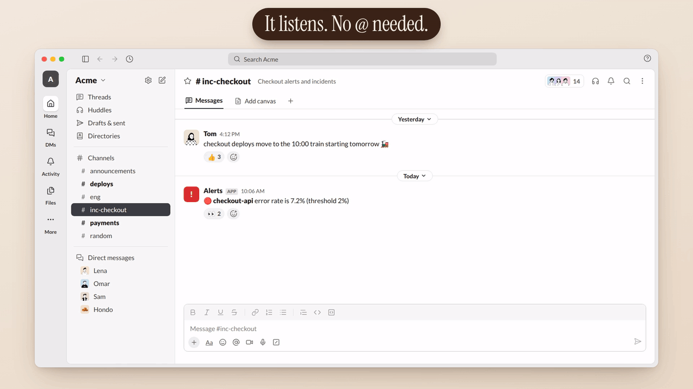

<p align="center">
  
</p>

<h1 align="center">Hondo</h1>

<p align="center">
  <strong>The open-source AI teammate for Slack.</strong><br />
  Self-hosted. Your model. Your tools.
</p>

<p align="center">
  
</p>

Hondo works in your Slack threads like a teammate. Ask it to find out why
checkout fails, and it checks the deploys, the pull requests, the traces, and
the flags, then answers in the thread with its sources.

- **It listens.** In channels that you select, Hondo reads along and answers
  when it can help, also without an `@`. Each channel has a goal, for example
  "Help with incidents. Not social chat."
- **It plans, and anyone can steer.** For longer work, a task list in the
  thread shows each step. Reply while it works, and Hondo uses your message
  at its next step.
- **It asks before it changes things.** Before a tool that can change data
  runs, a person in the channel approves the call in Slack.
- **It remembers.** Hondo keeps a short summary of each thread and finds
  earlier threads again ("we had the same thing on Oct 3"). What it learns
  in a private channel stays in that channel.
- **Your tools.** Connect remote MCP servers (GitHub, Atlassian, or any
  server with OAuth or a key), or define your own HTTP requests as tools.
  Admins approve each tool and select the channels that can use it. Skills
  hold your team's runbooks.
- **Your servers, your model.** Hondo runs on your infrastructure with your
  Vercel AI Gateway, OpenAI, or Anthropic key. Runs are durable: when the
  server restarts, a run continues where it stopped.

## Quick start

You need a server with Docker, a domain with HTTPS, and a Slack workspace
where you can install an app.

```sh
git clone https://github.com/mbroton/hondo.git
cd hondo
cp .env.example .env   # your HTTPS address, the Slack app values, two secrets
docker compose up -d
```

Then open your HTTPS address, select **Add to Slack**, and add a model key in
**Settings**. [docs/SELF-HOSTING.md](docs/SELF-HOSTING.md) has each step:
the Slack app, HTTPS, updates, and backups.

## How it works

One deployment serves one Slack workspace. It has three parts, all in one
Docker image:

- A **Slack worker** gets events through Socket Mode, so Slack needs no
  inbound access to the worker.
- **Runs** are durable workflows ([DBOS](https://www.dbos.dev/)) on Postgres.
  The agent is built with [Pydantic AI](https://ai.pydantic.dev/).
- An **API** serves the admin dashboard: connectors, skills, channels,
  models, and thread summaries.

Your data stays in your Postgres. The model provider gets the prompts and the
tool results, and your connected tools get the tool calls. Telemetry is off
by default.

## Status

Hondo is new. Expect rough edges, and tell us about them in an
[issue](https://github.com/mbroton/hondo/issues). The most useful report
tells what you asked, what Hondo did, and what you needed instead.

## Contributing

[CONTRIBUTING.md](CONTRIBUTING.md) shows the development setup. To report a
vulnerability, see [SECURITY.md](SECURITY.md).

## License

[Apache License 2.0](LICENSE)
